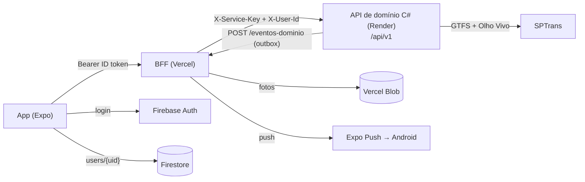

# Colecity

**Colecity** (cidade coletiva) é uma CitizenTech colaborativa para a cidade de São Paulo. Moradores relatam problemas urbanos (transporte, água, energia, vias, árvores, segurança e riscos), veem no mapa onde eles se concentram e, em vez de reclamar sozinhos, se juntam a quem enfrenta o mesmo problema, como afetados ou apoiadores, acompanhando cada ocorrência ao longo do tempo.

Projeto da **Global Solution 2026/2 · FIAP · Engenharia de Software**.

> O Colecity não é um canal oficial da Prefeitura e não encaminha manifestações a órgãos públicos.

## Integrantes

| Nome | RM |
|---|---|
| Guilherme Oliveira | RM 558797 |
| Matheus Dantas | RM 558804 |
| Rafael Panhoca | RM 555014 |
| Silas Alves | RM 555020 |
| Victor Rodriguez | RM 559094 |

## Ficha da CitizenTech

| Campo | Resposta |
|---|---|
| **Nome** | Colecity |
| **Cidade** | São Paulo, SP |
| **Cidadão beneficiado** | Moradores e usuários de serviços urbanos da cidade |
| **Problema** | Reclamações sobre problemas urbanos ficam isoladas: as pessoas não sabem o que está acontecendo agora, qual a extensão do problema nem quem mais é afetado |
| **Como funciona** | O cidadão consulta, registra e acompanha ocorrências por categoria e localização; ocorrências semelhantes são sugeridas antes de criar uma nova; participação separada entre "afetado" e "apoio"; comentários, linha do tempo e notificações; no transporte, os relatos são cruzados com os ônibus em tempo real da SPTrans |
| **Indicadores** | Ocorrências registradas, afetados e apoios por ocorrência, ocorrências concluídas, relatos cruzados com a SPTrans |
| **ODS** | 11 (cidades e comunidades sustentáveis), 10 (redução das desigualdades), 9 (indústria, inovação e infraestrutura) |

## Como o projeto está organizado

```
mobile/      App React Native/Expo do cidadão (login pelo Firebase Authentication)
bff/         BFF mobile (Node + TypeScript, Vercel): autenticação, repasse ao domínio, fotos e push
backend/     API de domínio em C#/.NET 10: regras de negócio, banco (EF Core), integração SPTrans Olho Vivo
docs/        Documentação do produto: visão, regras de negócio, arquitetura, features e casos de teste
```

## Arquitetura



- O **app** faz login no Firebase Authentication e chama só o BFF, levando o ID token. No Firestore ele guarda apenas os dados do próprio usuário (preferências, ocorrências silenciadas, aparelhos para push).
- O **BFF** valida o token, repassa ao domínio com a credencial de serviço e o `uid`, guarda as fotos no Vercel Blob e envia as notificações push quando o domínio avisa um evento.
- A **API de domínio** concentra as regras de negócio, o banco e a integração com a SPTrans. Ela nunca é chamada direto pelo app.

Detalhes no [doc 08](docs/08-arquitetura.md) (arquitetura) e no [doc 10](docs/10-contrato-api-dominio.md) (contrato do domínio).

| Parte | Onde roda | Endereço |
|---|---|---|
| API de domínio (C#) | Render, plano gratuito (Docker) | https://colecity.onrender.com/swagger |
| BFF | Vercel, plano Hobby | https://push-api-rho.vercel.app/health |
| App | APK pelo EAS Build | ver [`mobile/README.md`](mobile/README.md) |

O plano gratuito do Render dorme após cerca de 15 minutos sem uso (um ping a cada 5 minutos o mantém acordado) e volta aos dados de demonstração a cada deploy.

| Parte | O que é | Detalhes |
|---|---|---|
| **App mobile** | Porta de entrada do cidadão: explorar no mapa e em lista, registrar, participar, comentar, acompanhar, transporte ao vivo e perfil | [`mobile/README.md`](mobile/README.md) |
| **BFF mobile** | Única porta de entrada do app: valida o login, repassa ao domínio, guarda as fotos e envia as notificações push (Android) | [`bff/README.md`](bff/README.md) |
| **Backend C#** | Camada de serviços: domínio de ocorrências, persistência, documentação OpenAPI, testes e cruzamento dos relatos de transporte com a SPTrans; segue o contrato do [doc 10](docs/10-contrato-api-dominio.md) | [`backend/README.md`](backend/README.md) |
| **Documentação** | Regras de negócio, arquitetura e especificação usadas no desenvolvimento e nos testes | [`docs/README.md`](docs/README.md) |

## Entregas por disciplina

| Disciplina | Onde está |
|---|---|
| **Mobile Development & IoT** | [`mobile/`](mobile/README.md) — app Expo, README com Ficha, como rodar, prints e vídeo |
| **C# Software Development** | [`backend/`](backend/README.md) — Web API, EF Core, LINQ, async, testes |
| **Arquitetura Orientada a Serviços (SOA) e Web Services** | [`backend/`](backend/README.md) — domínio, banco, migrations, documentação automática e testes |
| **Testing, Compliance & Quality Assurance** | Projeto no Azure DevOps (Épicos, Features e Casos de Teste de Homologação): https://dev.azure.com/RM559094/Colecity · especificação em [`docs/11-features.md`](docs/11-features.md) e [`docs/12-test-cases.md`](docs/12-test-cases.md) |

## Vídeos

- **App rodando (Mobile, até 3 min):** https://youtu.be/xssyI-scp5E
- **App rodando — gravação completa, sem cortes:** https://youtu.be/1o-T05mNc84
- **Pitch (até 4 min):** https://youtu.be/3W9llloW2P0

## Como rodar

O backend e o BFF já estão publicados (tabela acima): para usar o app, basta rodá-lo. O passo a passo completo, inclusive como publicar cada parte, está no README de cada pasta.

```bash
# App mobile (Node 20+ e Expo Go no celular). Usa o BFF publicado; sem rede: EXPO_PUBLIC_DATA_SOURCE=mock
cd mobile && npm install && npm start

# Backend C# (.NET 10, ou Docker: ver backend/README.md)
cd backend && dotnet run --project src/Colecity.Api   # documentação em http://localhost:5080/swagger

# BFF (Node 20+)
cd bff && npm install && npx vercel dev
```

Ordem de publicação (uma vez): **Render** (backend, com `Seguranca__ServiceKey`) → **Vercel** (BFF, com `DOMINIO_URL` e a mesma chave em `DOMINIO_SERVICE_KEY`) → **Render** (`Bff__EventosUrl` apontando para o BFF) → **Firebase** (publicar `mobile/firestore.rules`) → **EAS** (build do app).
