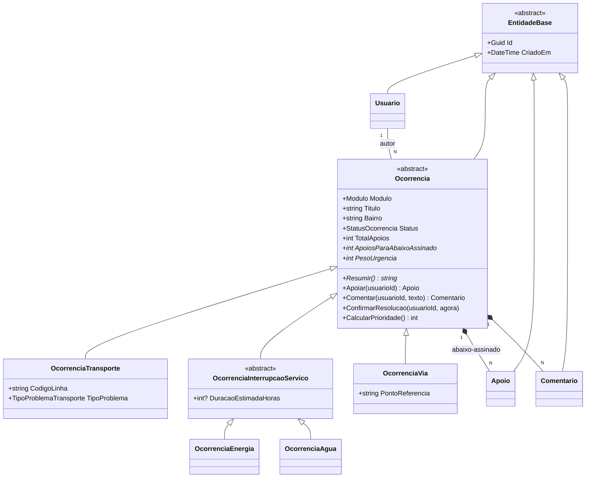

# Colecity: Backend (C# / .NET 10)

> **Colecity (cidade coletiva)** é uma plataforma colaborativa que junta, em um só lugar, os problemas do dia a dia de São Paulo. Quando várias pessoas relatam o mesmo problema, os relatos viram um **abaixo-assinado** que mostra ao poder público onde agir primeiro. O primeiro módulo é o de **transporte público**, que cruza os relatos com os dados em tempo real da **API Olho Vivo da SPTrans**.

Este repositório contém o **backend (Web API REST)** da solução. Ele é a entrega das disciplinas:

- **C# Software Development**
- **Arquitetura Orientada a Serviços (SOA) e Web Services**

## Integrantes

| Nome | RM |
|------|----|
| Guilherme Oliveira da Silva | RM558797 |
| Matheus Dantas | RM558804 |
| Rafael Panhoca | RM555014 |
| Silas Alves dos Santos | RM555020 |
| Victor Rodriguez | RM559094 |

---

## Ficha da CitizenTech

| Campo | Resposta |
|-------|----------|
| **Nome** | Colecity |
| **Cidade e bairro** | São Paulo, em qualquer bairro afetado pelos problemas tratados (dados de demonstração: Jardim Ângela, Capão Redondo, Grajaú, Jardim São Luís e Perdizes) |
| **Cidadão beneficiado** | Moradores de São Paulo que dependem do transporte público e enfrentam falta de luz, falta de água ou buracos nas ruas |
| **Problema, em uma frase** | Reclamações urbanas feitas de forma individual ficam isoladas, e o cidadão não se sente ouvido nem vê mudanças |
| **Como funciona** | O usuário registra e consulta ocorrências por módulo. Relatos do mesmo problema se juntam em um abaixo-assinado. O módulo de transporte cruza os relatos com os dados em tempo real da SPTrans |
| **O que esta parte faz** | API REST com as regras de negócio, persistência em banco, integração com a SPTrans e indicadores para o painel do poder público. App, web e demais partes consomem esta API |
| **Indicadores de impacto** | Pessoas por ocorrência · Taxa de resolução confirmada pelos usuários · Relatos de atraso cruzados com a SPTrans. Todos são expostos em `GET /api/painel/indicadores` |
| **ODS conectados** | **11** (cidades sustentáveis: melhora transporte e zeladoria com participação dos moradores) · **10** (redução das desigualdades: dá voz à periferia, onde a espera por ônibus é maior) · **9** (inovação e infraestrutura: usa dados abertos para mostrar onde a infraestrutura falha) |

### Evidências do problema

- Os contatos no 156 sobre ônibus cresceram 20,8% de 2021 para 2022 e chegaram a 65.729, principalmente por intervalos, espera e superlotação (Diário do Transporte).
- Em novembro de 2025, a Ouvidoria Geral do Município recebeu 5.123 protocolos, dos quais 4.461 eram reclamações. Só 49,8% foram finalizados com resposta (Prefeitura de SP).
- Hoje, cada protocolo do 156 representa **uma pessoa**. No Colecity, cada ocorrência mostra **quantas pessoas** enfrentam o mesmo problema.

---

## Arquitetura

A solução segue uma **arquitetura em camadas** (inspirada em Clean Architecture). Cada camada só depende das camadas mais internas e se comunica com elas por **interfaces**, resolvidas por **injeção de dependência**.

```
┌──────────────────────────────────────────────────────────────┐
│ Colecity.Api            Controllers REST · ProblemDetails ·   │
│                         OpenAPI + Scalar · Health check       │
├──────────────────────────────────────────────────────────────┤
│ Colecity.Application    Serviços (casos de uso) · DTOs ·      │
│                         Factory · contratos (ISpTransClient)  │
├──────────────────────────────────────────────────────────────┤
│ Colecity.Domain         Entidades ricas · regras de negócio · │
│                         interfaces de repositório             │
├──────────────────────────────────────────────────────────────┤
│ Colecity.Infrastructure EF Core + SQLite · Migrations ·       │
│                         Repositórios · Cliente HTTP SPTrans   │
└──────────────────────────────────────────────────────────────┘
          ▲ tests/Colecity.Tests: xUnit (domínio, serviços, HTTP, API)
```

| Projeto | Responsabilidade |
|---------|------------------|
| `src/Colecity.Domain` | Modelo de domínio sem dependência de framework: entidades, enums, exceções e contratos de repositório |
| `src/Colecity.Application` | Casos de uso (`OcorrenciaService`, `LinhaService`, `PainelService`, `UsuarioService`), DTOs com validação e contratos de serviços externos |
| `src/Colecity.Infrastructure` | `ColecityDbContext`, mapeamentos Fluent API, migrations, repositórios LINQ, clientes da SPTrans (real e simulado) e seed |
| `src/Colecity.Api` | Controllers, tratamento global de erros, documentação OpenAPI e composição da aplicação (`Program.cs`) |
| `tests/Colecity.Tests` | 40 testes automatizados |

### Modelo de domínio



**Regras de negócio** (todas dentro das entidades, protegidas por encapsulamento):

| Regra | Onde |
|-------|------|
| O autor é automaticamente o primeiro apoiador | `Ocorrencia` (construtor) |
| Cada usuário apoia uma ocorrência uma única vez (também garantido por índice único no banco) | `Ocorrencia.Apoiar` + `ApoioConfiguration` |
| A ocorrência vira **abaixo-assinado** ao atingir o mínimo do módulo: Transporte 10, Energia/Água 5, Vias 3 | `ApoiosParaAbaixoAssinado` (polimórfico) |
| Prioridade = apoios × peso de urgência do módulo: Água 3, Energia/Transporte 2, Vias 1 | `CalcularPrioridade` + `PesoUrgencia` (polimórfico) |
| Só quem apoia pode confirmar a resolução, e uma ocorrência resolvida não recebe novos apoios | `ConfirmarResolucao` |
| Só o autor edita. Só exclui enquanto ninguém mais apoiou | `Editar`, `GarantirQuePodeSerExcluidaPor` |

---

## Tecnologias

- **.NET 10 / C# 14**, ASP.NET Core Web API com Controllers
- **Entity Framework Core 10** com **SQLite** (herança TPH, Fluent API, Migrations)
- **OpenAPI** nativo do ASP.NET Core + **Scalar** (documentação interativa gerada automaticamente a partir dos XML comments)
- **IHttpClientFactory** para consumir a API REST **SPTrans Olho Vivo**
- **xUnit** + **WebApplicationFactory** (testes de integração) + SQLite em memória

---

## Como executar

### Pré-requisitos

- [.NET SDK 10](https://dotnet.microsoft.com/download/dotnet/10.0)
- (Opcional, só para criar novas migrations) `dotnet tool install --global dotnet-ef`

### Rodando a API

```bash
git clone <url-do-repositorio>
cd <pasta-do-repositorio>
dotnet run --project src/Colecity.Api
```

Na primeira execução, a API **aplica as migrations automaticamente** e cria o arquivo `colecity.db` com dados fictícios de demonstração. Depois, acesse:

| URL | O que é |
|-----|---------|
| http://localhost:5080/scalar | Documentação interativa dos endpoints (dá para testar pelo navegador) |
| http://localhost:5080/openapi/v1.json | Especificação OpenAPI 3.1 |
| http://localhost:5080/health | Health check |

> Para recriar o banco do zero, apague `src/Colecity.Api/colecity.db` e rode a API novamente.

### Banco de dados e migrations

A string de conexão fica em `src/Colecity.Api/appsettings.json` (`ConnectionStrings:Colecity`). A migration inicial está em `src/Colecity.Infrastructure/Data/Migrations`. Para criar ou aplicar migrations manualmente:

```bash
# criar uma nova migration
dotnet ef migrations add NomeDaMigration -p src/Colecity.Infrastructure -s src/Colecity.Api -o Data/Migrations

# aplicar as migrations no banco
dotnet ef database update -p src/Colecity.Infrastructure -s src/Colecity.Api
```

Para subir com o banco vazio (sem os dados de demonstração), use `Banco:PopularDadosDemo = false`.

### Integração com a SPTrans: dados simulados por padrão, API real pronta

**Decisão:** por ser um projeto acadêmico, a API usa por padrão **dados simulados** da SPTrans. Assim, qualquer pessoa clona e roda o projeto sem cadastro, token ou internet, e a demonstração é sempre a mesma. A linha `6072-10` foi simulada sem ônibus em operação para mostrar o alerta do cruzamento com os relatos.

Levamos em conta a integração real desde o início. O serviço de linhas depende só da interface `ISpTransClient`, que tem duas implementações com **o mesmo contrato**:

| Implementação | Quando é usada | O que faz |
|---------------|----------------|-----------|
| `SpTransSimuladoClient` | `SpTrans:Token` vazio (padrão) | Devolve linhas e posições de veículos simuladas, no formato da API real |
| `OlhoVivoSpTransClient` | `SpTrans:Token` preenchido | Chama a API **Olho Vivo** da SPTrans via `HttpClient`, com autenticação por cookie |

A escolha é feita na injeção de dependência (`AddSpTrans` em `Colecity.Infrastructure/DependencyInjection.cs`). Por isso, ligar os dados reais **não exige nenhuma mudança de código**. O cliente real é coberto por testes automatizados que simulam as respostas HTTP da Olho Vivo (`OlhoVivoSpTransClientTests`).

#### Passo a passo para usar a API real da SPTrans

1. **Criar uma conta** no portal do desenvolvedor: [sptrans.com.br/desenvolvedores](https://www.sptrans.com.br/desenvolvedores/). O acesso é gratuito.
2. **Criar um aplicativo** na área "Meus Aplicativos" do portal e copiar o **token** gerado.
3. **(Opcional) Testar o token direto na API.** A Olho Vivo autentica por cookie: primeiro se faz o login, depois as consultas reaproveitam o cookie.
   ```bash
   # autentica e guarda o cookie (a resposta esperada é: true)
   curl -s -c cookie.txt -X POST "https://api.olhovivo.sptrans.com.br/v2.1/Login/Autenticar?token=SEU_TOKEN"

   # busca a linha e anota o campo "cl" (código interno da linha)
   curl -s -b cookie.txt "https://api.olhovivo.sptrans.com.br/v2.1/Linha/Buscar?termosBusca=8000"

   # posição dos ônibus da linha agora
   curl -s -b cookie.txt "https://api.olhovivo.sptrans.com.br/v2.1/Posicao/Linha?codigoLinha=CODIGO_CL"
   ```
4. **Informar o token ao Colecity**, fora do código-fonte:
   ```bash
   dotnet user-secrets set "SpTrans:Token" "SEU_TOKEN" --project src/Colecity.Api
   # ou, por variável de ambiente: export SpTrans__Token=SEU_TOKEN
   ```
5. **Rodar a API normalmente** e consultar, por exemplo, `GET /api/linhas/8000-10/situacao`. Os veículos passam a vir da SPTrans em tempo real.

**Endpoints da Olho Vivo usados pelo Colecity:**

| Endpoint | Uso no Colecity |
|----------|-----------------|
| `POST /Login/Autenticar?token=` | Autenticação. É refeita automaticamente quando a API responde `401` |
| `GET /Linha/Buscar?termosBusca=` | `GET /api/linhas?termo=` e identificação dos dois sentidos da linha |
| `GET /Posicao/Linha?codigoLinha=` | Ônibus em operação por sentido em `GET /api/linhas/{letreiro}/situacao` |

Se a SPTrans estiver fora do ar ou recusar o token, a API responde `503 Service Unavailable` com ProblemDetails em vez de falhar com erro interno.

### Rodando os testes

```bash
dotnet test
```

---

## Endpoints

| Método | Rota | Descrição |
|--------|------|-----------|
| `GET` | `/api/usuarios` | Lista usuários |
| `GET` | `/api/usuarios/{id}` | Obtém um usuário |
| `POST` | `/api/usuarios` | Cadastra usuário (e-mail único) |
| `GET` | `/api/ocorrencias` | Lista ocorrências com filtros (`modulo`, `status`, `bairro`, `codigoLinha`) e paginação |
| `GET` | `/api/ocorrencias/{id}` | Obtém uma ocorrência |
| `POST` | `/api/ocorrencias` | Registra ocorrência. O tipo criado depende do `modulo` |
| `PUT` | `/api/ocorrencias/{id}` | Edita título e descrição (somente o autor) |
| `DELETE` | `/api/ocorrencias/{id}?usuarioId=` | Exclui (somente o autor, sem outros apoios) |
| `POST` | `/api/ocorrencias/{id}/apoios` | Assina o abaixo-assinado |
| `POST` | `/api/ocorrencias/{id}/resolucao` | Apoiador confirma que o problema foi resolvido |
| `GET` | `/api/ocorrencias/{id}/comentarios` | Lista comentários |
| `POST` | `/api/ocorrencias/{id}/comentarios` | Comenta na ocorrência |
| `GET` | `/api/linhas?termo=` | Busca linhas na SPTrans |
| `GET` | `/api/linhas/{letreiro}/situacao` | **Cruza** ônibus em operação (SPTrans) com os relatos da linha |
| `GET` | `/api/painel/indicadores` | Indicadores de impacto |
| `GET` | `/api/painel/ranking?modulo=&top=` | Onde agir primeiro: ranking por prioridade |

Os erros seguem o padrão **ProblemDetails (RFC 9457)**: `400` para validação, `404` para recurso inexistente, `409` para conflito, `422` para regra de negócio violada e `503` quando a SPTrans está indisponível.

### Exemplo: registrar uma ocorrência de transporte

```bash
curl -X POST http://localhost:5080/api/ocorrencias \
  -H "Content-Type: application/json" \
  -d '{
    "modulo": "Transporte",
    "autorId": "<id-de-um-usuario>",
    "titulo": "Ônibus não passa depois das 22h",
    "descricao": "Espero mais de 1 hora no ponto.",
    "bairro": "Jardim Ângela",
    "codigoLinha": "6072-10",
    "tipoProblema": "NaoPassou"
  }'
```

### Exemplo: cruzamento SPTrans × relatos

`GET /api/linhas/6072-10/situacao`

```json
{
  "letreiro": "6072-10",
  "horarioReferenciaSpTrans": "22:21",
  "sentidos": [
    { "sentido": 1, "destino": "JD. HERCULANO", "veiculosEmOperacao": 0, "veiculosAcessiveis": 0 },
    { "sentido": 2, "destino": "TERM. VARGINHA", "veiculosEmOperacao": 0, "veiculosAcessiveis": 0 }
  ],
  "totalVeiculosEmOperacao": 0,
  "ocorrenciasAtivas": 1,
  "pessoasAfetadas": 10,
  "problemaMaisRelatado": "NaoPassou",
  "alerta": "SPTrans não mostra ônibus em operação e 10 pessoa(s) relatam que a linha não está passando."
}
```

---

## Evidências

Ficam em [`docs/evidencias`](docs/evidencias):

- [`01-scalar-documentacao.png`](docs/evidencias/01-scalar-documentacao.png): documentação automática no Scalar
- [`02-chamadas-api.md`](docs/evidencias/02-chamadas-api.md): jornada completa com requisições e respostas reais (cadastro → consulta da linha → apoio → comentário → novo relato → erros → painel)
- [`03-testes-automatizados.txt`](docs/evidencias/03-testes-automatizados.txt): execução dos 40 testes

Para gerar as evidências de chamadas novamente, com a API rodando: `./scripts/demo-api.sh > docs/evidencias/02-chamadas-api.md`

---

## Critérios de avaliação × implementação

### C# Software Development

| Critério | Onde está no código |
|----------|---------------------|
| **POO (3,0)** | **Abstração e herança:** `EntidadeBase` → `Ocorrencia` (abstrata) → `OcorrenciaTransporte`, `OcorrenciaVia` e `OcorrenciaInterrupcaoServico` (abstrata) → `OcorrenciaEnergia`, `OcorrenciaAgua`. **Polimorfismo:** `Resumir()`, `PesoUrgencia` e `ApoiosParaAbaixoAssinado` sobrescritos por módulo e usados em `CalcularPrioridade()`. **Encapsulamento:** setters privados, coleções expostas como `IReadOnlyCollection` com backing fields, validações nos construtores. **Interfaces:** repositórios, `IUnitOfWork`, `ISpTransClient` (2 implementações intercambiáveis), serviços. **Factory:** `OcorrenciaFactory` |
| **Web API (2,5)** | 4 controllers REST com 16 endpoints, verbos e status HTTP corretos (`201 + Location`, `204`, `400`, `404`, `409`, `422`, `503`), validação com DataAnnotations, filtros e paginação, tratamento global de erros (`ExcecaoHandler` + ProblemDetails), documentação OpenAPI/Scalar, CORS e health check |
| **EF Core + LINQ (1,5)** | `ColecityDbContext`, mapeamentos Fluent API (`Data/Configurations`), herança **TPH** com discriminador, conversão de enums, índices únicos, migrations. LINQ em `OcorrenciaRepository` (filtros dinâmicos, `OfType`, `Include`, paginação), `PainelConsultas` (`GroupBy`, `join`, `Count`, `COUNT DISTINCT` traduzidos para SQL) e LINQ to Objects nos serviços (`Zip`, `GroupBy`, `OrderBy`) |
| **Async/Await (1,0)** | Toda a pilha é assíncrona e propaga `CancellationToken`: controllers → serviços → repositórios (`ToListAsync`, `SaveChangesAsync`) → `HttpClient`. `LinhaService` consulta os sentidos da linha na SPTrans e o banco **em paralelo** com `Task.WhenAll` |
| **Qualidade do código (2,0)** | Arquitetura em camadas, injeção de dependência, SOLID, `TreatWarningsAsErrors`, nullable habilitado, nomes do domínio em português, `TimeProvider` para testabilidade, 40 testes automatizados, README e evidências |

### Arquitetura Orientada a Serviços (SOA) e Web Services

| Critério | Onde está no código |
|----------|---------------------|
| **Estruturação do domínio (3,0)** | Projeto `Colecity.Domain` isolado de frameworks, com entidades ricas, invariantes e regras de negócio (abaixo-assinado, prioridade, resolução) e contratos de repositório. Veja o diagrama e a tabela de regras acima |
| **Conexão com banco de dados (3,0)** | EF Core + SQLite, `ColecityDbContext` registrado via DI com string de conexão configurável, repositórios e Unit of Work, relacionamentos 1:N com FKs, cascata e índices. Inclui consumo de API REST externa (SPTrans) com `IHttpClientFactory` |
| **Migrações (1,5)** | `Data/Migrations/*_Inicial.cs`, aplicadas automaticamente no startup (`InicializarBancoAsync`) e também via `dotnet ef database update`. Os testes rodam sobre as mesmas migrations |
| **Documentação automática (1,5)** | OpenAPI 3.1 gerado pelo ASP.NET Core a partir dos controllers e XML comments (`/openapi/v1.json`), com interface interativa **Scalar** (`/scalar`) |
| **Testes automatizados (1,0)** | 40 testes xUnit: domínio (regras), serviços com banco SQLite real em memória, cliente HTTP da SPTrans com handler falso e integração de ponta a ponta da API com `WebApplicationFactory` |

---

## Dados utilizados

- **Nenhum dado pessoal real.** Usuários e relatos são **fictícios**, criados em `DataSeeder` com e-mails `@exemplo.com`.
- **SPTrans:** dados reais da API pública Olho Vivo quando há token configurado. Sem token, os dados são **simulados** em `SpTransSimuladoClient`, no mesmo formato da API.
- Estatísticas do problema: Diário do Transporte, Metrópoles, DGABC e Prefeitura de São Paulo, conforme o documento de posicionamento do Colecity.

## Limitações e próximos passos

- O MVP identifica o usuário pelo `usuarioId` enviado na requisição. A próxima etapa é adicionar autenticação (JWT) e tirar esse campo do corpo.
- Adicionar geolocalização às ocorrências para exibição em mapa.
- Trocar o SQLite por um banco gerenciado (SQL Server, PostgreSQL ou Oracle) em produção. Para isso, basta trocar o provider em `AddInfrastructure` e gerar novas migrations.

## Uso de IA

A IA foi usada como copiloto, como permitem as regras da GS. Os prompts estão registrados em [`prompts.md`](prompts.md).
