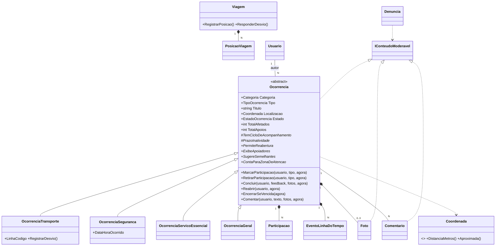

# Colecity: API de domínio (C# / .NET 10)

> **Colecity (cidade coletiva)** é uma CitizenTech colaborativa para relatar, acompanhar e se mobilizar em torno de problemas urbanos da cidade de São Paulo. Quando várias pessoas enfrentam o mesmo problema, o relato ganha força coletiva e mostra onde a cidade precisa agir primeiro.

Esta pasta contém a **API de domínio** do Colecity: a Web API REST que é **dona de todas as regras de negócio** do produto (doc [07](../docs/07-regras-de-negocio-produto.md)) e implementa o contrato do doc [10](../docs/10-contrato-api-dominio.md). É a entrega das disciplinas:

- **C# Software Development**
- **Arquitetura Orientada a Serviços (SOA) e Web Services**

## Integrantes

| Nome | RM |
|------|----|
| Guilherme Oliveira da Silva | RM558797 |
| Matheus Dantas | RM558804 |
| Rafael Panhoca | RM555014 |
| Silas Alves dos Santos | RM555020 |
| Victor Rodriguez | RM559094 |

---

## Ficha da CitizenTech

| Campo | Resposta |
|-------|----------|
| **Nome** | Colecity |
| **Cidade** | São Paulo, SP |
| **Cidadão beneficiado** | Moradores e usuários de serviços urbanos da cidade, como transporte, água, energia, vias, árvores, segurança e áreas de risco |
| **Problema, em uma frase** | Reclamações urbanas feitas de forma individual ficam isoladas: o cidadão não se sente ouvido e o poder público não enxerga a dimensão real do problema |
| **Como funciona** | O cidadão consulta, registra e acompanha ocorrências por categoria e localização. Outras pessoas marcam "Também estou sendo afetado" ou "Apoiar manifestação", comentam e acompanham a linha do tempo. O transporte ao vivo cruza os dados da SPTrans com a posição de passageiros para detectar desvios de rota |
| **O que esta parte faz** | API de domínio em C#: regras de negócio, persistência, integrações (SPTrans, geocodificação), tarefas automáticas e eventos para o BFF. O app Expo fala com o BFF (Firebase Cloud Functions), e o BFF fala com esta API |
| **Indicadores de impacto** | Ocorrências registradas · afetados e apoios por ocorrência · ocorrências concluídas · desvios de rota detectados |
| **ODS** | **11** (cidades e comunidades sustentáveis) · **10** (redução das desigualdades) · **9** (indústria, inovação e infraestrutura) |

> O Colecity não é um canal oficial da Prefeitura e não encaminha manifestações a órgãos públicos.

---

## Onde esta API entra na arquitetura

```
App Expo ──HTTPS + token Firebase──► BFF (Cloud Functions) ──HTTPS + X-Service-Key──► API de domínio (este projeto)
                                          ▲                                                 │
                                          └──────────── eventos de domínio (push) ──────────┘
```

Conforme o [doc 08](../docs/08-arquitetura.md), **o domínio não conhece plataformas**: não valida token do Firebase, não envia push e não conhece telas. Ele confia no usuário informado pelo BFF:

| Header | Uso |
|--------|-----|
| `X-Service-Key` | Segredo compartilhado entre BFF e domínio. Obrigatório em todas as rotas, exceto `/health`. Sem ele, ou inválido → `401` |
| `X-User-Id` | `uid` do Firebase, já validado pelo BFF. Obrigatório nas rotas 🔒; opcional nas públicas, onde preenche `minhaParticipacao` |
| `Idempotency-Key` | Obrigatório nas criações ⟳ (ocorrência e comentário). A mesma chave em até 24 h devolve a mesma resposta, sem criar de novo, o que protege a fila offline do app |

---

## Arquitetura da solução

Arquitetura em camadas (inspirada em Clean Architecture). Cada camada só conhece as camadas internas e se comunica com elas por **interfaces** resolvidas por **injeção de dependência**.

```
┌──────────────────────────────────────────────────────────────────────────┐
│ Colecity.Api            Controllers REST · autenticação BFF · filtro de     │
│                         idempotência · rate limit · ProblemDetails · OpenAPI│
├──────────────────────────────────────────────────────────────────────────┤
│ Colecity.Application    Casos de uso (serviços) · DTOs do contrato ·        │
│                         contratos de leitura · tarefas agendadas           │
├──────────────────────────────────────────────────────────────────────────┤
│ Colecity.Domain         Entidades ricas · política por categoria ·          │
│                         geografia · eventos de domínio · repositórios      │
├──────────────────────────────────────────────────────────────────────────┤
│ Colecity.Infrastructure EF Core + SQLite · migrations · consultas LINQ ·    │
│                         GTFS · Olho Vivo · Nominatim · outbox → BFF        │
└──────────────────────────────────────────────────────────────────────────┘
        tests/Colecity.Tests: 107 testes (domínio, aplicação + banco real, HTTP)
```

Decisões que vale destacar:

- **Comandos x consultas (CQRS simples).** Alterações passam pelos agregados e repositórios, que aplicam as regras. As telas de leitura usam projeções LINQ (`OcorrenciaConsultas`, `MapaConsultas`), que já aplicam visibilidade (moderação), ordenação e localização aproximada.
- **Outbox de eventos.** Mudança de estado, comentário e desvio confirmado geram eventos de domínio. Eles são gravados na **mesma transação** da operação (`ColecityDbContext.SaveChangesAsync`) e enviados ao BFF em segundo plano com 3 tentativas e intervalo crescente. Assim, uma falha de envio nunca desfaz a operação de negócio (doc 10, seção 5).
- **Política por categoria com polimorfismo.** Cada especialização de `Ocorrencia` define as próprias regras: ciclo de acompanhamento, prazo de encerramento, reabertura, apoiadores, semelhantes e zona de atenção.

### Modelo de domínio



| Especialização | Categorias | O que muda (polimorfismo) |
|----------------|-----------|---------------------------|
| `OcorrenciaTransporte` | Transporte | Pode citar a linha (validada no GTFS) e recebe desvios confirmados por passageiros |
| `OcorrenciaSeguranca` | Segurança | Data do ocorrido; sem ciclo de acompanhamento, sem reabertura, sem apoiadores, sem semelhantes; conclui sozinha em 30 dias; conta para Zona de atenção |
| `OcorrenciaServicoEssencial` | Água, Energia | Encerra após **7** dias sem atividade |
| `OcorrenciaGeral` | Vias, Árvores, Riscos e infraestrutura | Encerra após 30 dias sem atividade; Riscos conta para Zona de atenção |

### Regras de negócio implementadas (doc 07)

| Regras | Onde |
|--------|------|
| RN-REG-02 a 09: campos obrigatórios, descrição de 10 a 500 caracteres, tipo da categoria, município de SP, até 3 fotos WebP do próprio usuário, título "Tipo – Rua, Bairro", autor afetado, edição só de descrição e fotos | `Ocorrencia`, `Foto`, `MunicipioSaoPaulo`, `OcorrenciaService` |
| RN-REG-10: não existe exclusão de ocorrência | Não há endpoint nem método |
| RN-PAR-01 a 07: participação idempotente com contagens separadas, autor não apoia nem deixa de ser afetado, sem participação após concluir, apoiadores públicos exceto em Segurança | `Ocorrencia.MarcarParticipacao/RetirarParticipacao`, `OcorrenciaConsultas.ApoiadoresAsync` |
| RN-ACO-01 a 09: Em acompanhamento com 3 afetados, linha do tempo com marcos de 10, 50 e 100, conclusão só pelo autor com feedback, reabertura por afetado em 7 dias, encerramento automático por categoria | `Ocorrencia`, especializações, `EncerramentoAutomaticoTarefa` |
| RN-CSL e RN-DES: consulta pública, filtros de categoria, estado e raio (1, 5 ou 10 km), localização aproximada (~100 m), ordenação por afetados + apoios, mapa de calor por afetados distintos | `OcorrenciaConsultas`, `MapaConsultas`, `Coordenada.Aproximada` |
| RN-SEM: até 5 semelhantes, mesma categoria e tipo, até 500 m, atividade em 7 dias; mesma linha em Transporte; nunca em Segurança | `OcorrenciaConsultas.SemelhantesAsync` |
| RN-ZON: 5+ contas distintas, 300 m, 30 dias, só Segurança e Riscos, texto com a origem | `CalculadoraZonasAtencao`, `ZonasAtencaoTarefa` |
| RN-COM: comentários de 1 a 500 caracteres, ordem cronológica, selo "Afetado", exclusão só pelo autor | `Comentario`, `ComentarioService` |
| RN-MOD: uma denúncia por conta; com 5 contas, o conteúdo fica oculto até a revisão | `Denuncia`, `ModeracaoService` |
| RN-MIN: abas Registradas, Afetado e Apoio, não concluídas primeiro | `OcorrenciaConsultas.MinhasAsync` |
| RN-TAV: linhas e trajetos do GTFS, ônibus da Olho Vivo (cache de 15 s), uma viagem ativa por usuário, expiração em 2 h, 10 min parado fora do trajeto encerra, desvio com mais de 300 m em 3 posições seguidas, posições apagadas em 24 h | `Viagem`, `Trajeto`, `AgregadorPosicoesPassageiros`, `TransporteService`, `LimpezaTarefa` |
| RN-CON-08: exclusão de conta por anonimização | `Usuario.Anonimizar`, `UsuarioService.ExcluirContaAsync` |
| RN-GER-12: 30 requisições/min por usuário ou IP → `429` | `LimiteRequisicoes` |

---

## Tecnologias

- **.NET 10 / C# 14**, ASP.NET Core Web API com Controllers
- **Entity Framework Core 10 + SQLite**: herança TPH, tipos owned, coleções owned, conversões, índices, migrations, split queries
- **OpenAPI 3.1** nativo do ASP.NET Core, com **Swagger UI** e **Scalar** gerados automaticamente a partir dos XML comments
- **Autenticação por esquema próprio** (`AuthenticationHandler`) e políticas de autorização
- **Rate limiting**, **health checks**, **ProblemDetails**, **IHttpClientFactory**, **IMemoryCache**, **BackgroundService/PeriodicTimer**
- **xUnit** + **WebApplicationFactory** + SQLite em memória

---

## Como executar

### Pré-requisitos

- [.NET SDK 10](https://dotnet.microsoft.com/download/dotnet/10.0)
- (Opcional, só para criar novas migrations) `dotnet tool install --global dotnet-ef`

### Rodando

```bash
cd backend
dotnet run --project src/Colecity.Api
```

Na primeira execução, a API:

1. aplica as **migrations**, criando `src/Colecity.Api/colecity.db`;
2. importa o **GTFS** de amostra para as tabelas de linhas e trajetos;
3. cria **dados fictícios** de demonstração: 12 usuários, ocorrências em todas as categorias, uma Zona de atenção na Sé, uma ocorrência concluída por inatividade e outra pelo autor.

| URL | O que é |
|-----|---------|
| http://localhost:5080/swagger | Documentação interativa (Swagger UI) |
| http://localhost:5080/scalar | Documentação interativa (Scalar) |
| http://localhost:5080/openapi/v1.json | Especificação OpenAPI 3.1 |
| http://localhost:5080/health | Health check (`{"status":"ok"}`), sem autenticação |

### Testando pelo Swagger

1. Abra http://localhost:5080/swagger e clique em **Authorize**.
2. Preencha `ServiceKey` com `dev-service-key-colecity`, a chave de desenvolvimento definida em `appsettings.Development.json`.
3. Para rotas 🔒, preencha `UserId` com um usuário de demonstração, por exemplo `demo-ana`. Os outros são `demo-bruno`, `demo-carla`, `demo-diego`, `demo-eduarda`, `demo-felipe`, `demo-gabriela`, `demo-henrique`, `demo-isabela`, `demo-joao`, `demo-larissa` e `demo-marcos`.
4. As rotas de moderação (`/admin/...`) usam `AdminKey` = `dev-admin-key-colecity`.

Para rodar a jornada completa pelo terminal, com a API no ar: `./scripts/demo-api.sh`.

### Configuração

| Chave (`appsettings.json` ou variável de ambiente) | Padrão | Para quê |
|-----|-----|-----|
| `ConnectionStrings:Colecity` | `Data Source=colecity.db` | Banco SQLite |
| `Seguranca:ServiceKey` | **obrigatória** (só o ambiente de desenvolvimento tem valor) | Credencial do BFF. Em produção: `Seguranca__ServiceKey` |
| `Seguranca:AdminKey` | vazia (desliga o admin) | Credencial da moderação |
| `SpTrans:Token` | vazio = SPTrans simulada | Token da API Olho Vivo |
| `Gtfs:Diretorio` | vazio = amostra embutida | Pasta com o GTFS completo da SPTrans |
| `Geocodificacao:Provedor` | `Nominatim` | `Nominatim` (OpenStreetMap) ou `Simulado` (offline) |
| `Bff:EventosUrl` | vazio = eventos só em log | URL da função `eventosDominio` do BFF |
| `RateLimit:RequisicoesPorMinuto` | `30` | RN-GER-12 |
| `Banco:PopularDadosDemo` | `true` | Dados fictícios na primeira execução |
| `Tarefas:Habilitadas` | `true` | Tarefas em segundo plano |

Sem `Seguranca:ServiceKey` fora do ambiente de desenvolvimento, a API **não sobe**. É de propósito: o segredo nunca fica no repositório (doc 08, seção 7).

### Banco de dados e migrations

O doc 08 (seção 10) deixa a escolha do banco com o time do backend. Usamos **SQLite**, que roda em qualquer máquina sem instalação. As consultas geográficas filtram primeiro por uma caixa delimitadora no banco e depois calculam a distância exata (Haversine) em memória. A migration fica em `src/Colecity.Infrastructure/Data/Migrations` e é aplicada automaticamente na inicialização. Para aplicar ou criar migrations manualmente:

```bash
dotnet ef database update -p src/Colecity.Infrastructure -s src/Colecity.Api
dotnet ef migrations add NomeDaMigration -p src/Colecity.Infrastructure -s src/Colecity.Api -o Data/Migrations
```

Para recriar o banco do zero, apague `src/Colecity.Api/colecity.db` e rode a API de novo.

### Rodando os testes

```bash
dotnet test
```

---

## Integrações externas

### SPTrans: dados simulados por padrão, API real pronta

**Decisão:** por ser um projeto acadêmico, a API usa por padrão **dados simulados** da SPTrans. Assim, qualquer pessoa clona e roda o projeto sem cadastro, token ou internet, e a demonstração sai sempre igual. Os ônibus simulados andam sobre o trajeto do GTFS conforme o relógio.

Levamos em conta a integração real desde o início. O serviço de transporte depende só da interface `ISpTransClient`, que tem duas implementações com **o mesmo contrato**, as duas envolvidas por um decorator com cache de 15 s (`SpTransComCache`, RN-TAV-03):

| Implementação | Quando é usada | O que faz |
|---------------|----------------|-----------|
| `SpTransSimuladoClient` | `SpTrans:Token` vazio (padrão) | Gera ônibus sobre o trajeto do GTFS, no formato da API real |
| `OlhoVivoSpTransClient` | `SpTrans:Token` preenchido | Chama a API **Olho Vivo** via `HttpClient`, com autenticação por cookie |

A escolha acontece na injeção de dependência (`AddSpTrans`, em `Colecity.Infrastructure/DependencyInjection.cs`), então ligar os dados reais **não exige mudança de código**. O cliente real é coberto por testes que simulam as respostas HTTP da Olho Vivo (`OlhoVivoSpTransClientTests`).

#### Passo a passo para usar a API real da SPTrans

1. **Criar uma conta** no portal do desenvolvedor: [sptrans.com.br/desenvolvedores](https://www.sptrans.com.br/desenvolvedores/). O acesso é gratuito.
2. **Criar um aplicativo** na área "Meus Aplicativos" e copiar o **token** gerado.
3. **(Opcional) Testar o token direto na API.** A Olho Vivo autentica por cookie:
   ```bash
   # autentica e guarda o cookie (resposta esperada: true)
   curl -s -c cookie.txt -X POST "https://api.olhovivo.sptrans.com.br/v2.1/Login/Autenticar?token=SEU_TOKEN"
   # busca a linha e anota o campo "cl" (código interno)
   curl -s -b cookie.txt "https://api.olhovivo.sptrans.com.br/v2.1/Linha/Buscar?termosBusca=8700"
   # posição dos ônibus da linha agora
   curl -s -b cookie.txt "https://api.olhovivo.sptrans.com.br/v2.1/Posicao/Linha?codigoLinha=CODIGO_CL"
   ```
4. **Informar o token ao Colecity**, fora do código-fonte (o doc 08 manda o token ficar só no domínio):
   ```bash
   dotnet user-secrets set "SpTrans:Token" "SEU_TOKEN" --project src/Colecity.Api
   # ou: export SpTrans__Token=SEU_TOKEN
   ```
5. **Rodar a API** e consultar `GET /api/v1/transporte/linhas/8700-10/veiculos?sentido=1`. Os ônibus passam a vir da SPTrans em tempo real.

| Endpoint da Olho Vivo | Uso no Colecity |
|----------|-----------------|
| `POST /Login/Autenticar?token=` | Autenticação, refeita automaticamente quando a API responde `401` |
| `GET /Linha/Buscar?termosBusca=` | Encontra o código interno (`cl`) da linha e do sentido |
| `GET /Posicao/Linha?codigoLinha=` | Ônibus marcados como `SPTRANS` em `/transporte/linhas/{codigo}/veiculos` |

Se a SPTrans cair, a tela de veículos continua respondendo com as posições de passageiros, e o erro só aparece no log.

### GTFS da SPTrans: amostra embutida

Linhas e trajetos vêm do GTFS (RN-TAV-01, 02), importado para as tabelas `GtfsLinhas`, `GtfsSentidos` e `GtfsPontosTrajeto`. O projeto traz uma **amostra simulada** com 4 linhas, no formato oficial (`routes.txt`, `trips.txt`, `shapes.txt`), em `src/Colecity.Infrastructure/Transporte/Gtfs`. Para usar o GTFS completo, baixe-o na área logada do portal da SPTrans e aponte `Gtfs:Diretorio` para a pasta. A importação roda na inicialização e é refeita uma vez por dia.

### Geocodificação reversa: Nominatim (OpenStreetMap)

O título "Tipo – Rua, Bairro" (RN-REG-07) usa o **Nominatim**, que é gratuito e não precisa de token. A aplicação se identifica no `User-Agent`, guarda as respostas em cache por região de ~100 m e usa timeout de 3 s. Se o serviço falhar, a ocorrência é criada com o título "Tipo – Localização aproximada", como o doc 10 prevê, e a tarefa `GeocodificacaoPendenteTarefa` completa o título depois. Para rodar totalmente offline, use `Geocodificacao:Provedor = Simulado`, que devolve o bairro de referência mais próximo.

### Eventos para o BFF

`ocorrencia.estado_alterado`, `ocorrencia.comentario_criado` e `transporte.desvio_confirmado` são enviados para `Bff:EventosUrl` com `X-Service-Key`, `eventId` único e `destinatariosUids` calculados pelo domínio: autor, afetados e apoiadores, sem quem causou o evento. Enquanto o BFF não estiver publicado, os eventos ficam registrados no log, sem uid nem e-mail (LGPD).

---

## Endpoints

Base: `/api/v1`. Legenda: 🔒 exige `X-User-Id` · ⟳ exige `Idempotency-Key`.

| Método e rota | Descrição |
|---|---|
| `PUT /usuarios/me` 🔒 | Cria ou atualiza o usuário no primeiro acesso (aceite dos termos) |
| `GET /usuarios/me` 🔒 | Dados do usuário |
| `PATCH /usuarios/me` 🔒 | Altera nome e/ou e-mail |
| `DELETE /usuarios/me` 🔒 | Exclui a conta por anonimização |
| `GET /usuarios/me/ocorrencias?aba=` 🔒 | Minhas ocorrências: `REGISTRADAS`, `AFETADO` ou `APOIO` |
| `GET /categorias` | Categorias e tipos |
| `GET /ocorrencias` | Lista com filtros `categoria`, `estado`, `lat`/`lng`/`raioKm`, `linha` e paginação |
| `GET /ocorrencias/{id}` | Detalhe |
| `GET /ocorrencias/{id}/linha-do-tempo` | Eventos automáticos |
| `GET /ocorrencias/{id}/apoiadores` | Nomes de quem apoia |
| `POST /ocorrencias/semelhantes` 🔒 | Até 5 sugestões antes de registrar |
| `POST /ocorrencias` 🔒 ⟳ | Registra a ocorrência |
| `PATCH /ocorrencias/{id}` 🔒 | Edita descrição e fotos (autor) |
| `POST /ocorrencias/{id}/conclusao` 🔒 | Conclui (autor) |
| `POST /ocorrencias/{id}/reabertura` 🔒 | Reabre (afetado, até 7 dias) |
| `PUT` / `DELETE /ocorrencias/{id}/participacoes/{afetado\|apoio}` 🔒 | Marca ou retira a participação |
| `GET /ocorrencias/{id}/comentarios` | Comentários |
| `POST /ocorrencias/{id}/comentarios` 🔒 ⟳ | Comenta |
| `DELETE /comentarios/{id}` 🔒 | Exclui o próprio comentário |
| `POST /denuncias` 🔒 | Denuncia uma ocorrência, comentário ou foto |
| `GET /admin/denuncias` · `POST /admin/denuncias/{conteudoId}/decisao` | Moderação (`X-Admin-Key`) |
| `GET /mapa/calor` · `GET /mapa/zonas-atencao` | Mapa de calor e Zonas de atenção |
| `GET /transporte/linhas?busca=` | Busca linhas no GTFS |
| `GET /transporte/linhas/{codigo}/trajeto?sentido=` | Trajeto oficial |
| `GET /transporte/linhas/{codigo}/veiculos?sentido=` | Ônibus `SPTRANS` e `PASSAGEIROS` |
| `POST /transporte/viagens` 🔒 | "Estou neste ônibus" |
| `POST /transporte/viagens/{id}/posicoes` 🔒 | Posição a cada minuto, com detecção de desvio |
| `POST /transporte/viagens/{id}/desvio` 🔒 | Confirma ou nega o desvio |
| `POST /transporte/viagens/{id}/encerrar` 🔒 | Encerra a viagem |
| `GET /health` | Health check |

### Erros

Todos os erros seguem o **Problem Details (RFC 7807)** com `code` estável, que é o mesmo conjunto de códigos tipado no app (`mobile/src/types/api.ts`):

```json
{ "type": "about:blank", "title": "Por enquanto o Colecity funciona apenas na cidade de São Paulo.", "status": 422,
  "code": "LOCALIZACAO_FORA_DO_MUNICIPIO", "errors": { "localizacao": ["Por enquanto o Colecity funciona apenas na cidade de São Paulo."] } }
```

| Status | Quando |
|---|---|
| `400` | JSON malformado, tipo inválido, campo não permitido no PATCH, parâmetro inválido (`REQUISICAO_INVALIDA`, `IDEMPOTENCY_KEY_OBRIGATORIA`) |
| `401` | Sem `X-Service-Key` válido, ou rota 🔒 sem `X-User-Id` (`NAO_AUTENTICADO`) |
| `403` | `USUARIO_NAO_CADASTRADO`, `SOMENTE_AUTOR`, `SOMENTE_AFETADO` |
| `404` | Recurso inexistente ou oculto pela moderação (`NAO_ENCONTRADO`) |
| `409` | `OCORRENCIA_CONCLUIDA`, `EMAIL_JA_CADASTRADO`, `DENUNCIA_JA_REGISTRADA` |
| `422` | Regras de negócio: `CAMPO_OBRIGATORIO`, `DESCRICAO_TAMANHO_INVALIDO`, `TIPO_INVALIDO_PARA_CATEGORIA`, `LOCALIZACAO_FORA_DO_MUNICIPIO`, `LINHA_INVALIDA`, `DATA_OCORRIDO_INVALIDA`, `FOTO_INVALIDA`, `LIMITE_FOTOS_EXCEDIDO`, `AUTOR_NAO_PODE_APOIAR`, `AUTOR_SEMPRE_AFETADO`, `PRAZO_REABERTURA_EXPIRADO`, `REABERTURA_NAO_PERMITIDA`, `COMENTARIO_TAMANHO_INVALIDO`, `ACEITE_TERMOS_OBRIGATORIO`, `NOME_INVALIDO`… |
| `429` | Limite de requisições (`MUITAS_REQUISICOES`) |

### Tarefas em segundo plano

| Tarefa | Frequência | Regra |
|---|---|---|
| `EncerramentoAutomaticoTarefa` | 1 h | Inatividade de 7 dias (Água e Energia) ou 30 dias; Segurança após 30 dias (RN-ACO-06, 09) |
| `ZonasAtencaoTarefa` | 5 min | Recalcula as Zonas de atenção (RN-ZON) |
| `PublicadorEventosTarefa` | 10 s | Envia o outbox ao BFF |
| `GeocodificacaoPendenteTarefa` | 5 min | Completa títulos sem endereço |
| `LimpezaTarefa` | 1 h | Apaga posições com mais de 24 h (RN-TAV-06), chaves de idempotência vencidas e eventos já enviados; encerra viagens expiradas |
| `GtfsImportador` | 24 h | Reimporta o GTFS |

---

## Evidências

Em [`docs/evidencias`](docs/evidencias):

- [`01-swagger-documentacao.png`](docs/evidencias/01-swagger-documentacao.png) e [`01-scalar-documentacao.png`](docs/evidencias/01-scalar-documentacao.png): documentação automática
- [`02-chamadas-api.md`](docs/evidencias/02-chamadas-api.md): jornada completa com requisições e respostas reais, gerada por `./scripts/demo-api.sh`. Passa por cadastro, consulta, semelhantes, registro idempotente, participação, comentário, conclusão, erros, mapa, transporte com desvio e exclusão de conta
- [`03-testes-automatizados.txt`](docs/evidencias/03-testes-automatizados.txt): execução dos 107 testes

---

## Critérios de avaliação × implementação

### C# Software Development

| Critério | Onde está |
|----------|-----------|
| **POO (3,0)** | **Herança e abstração:** `Ocorrencia` (abstrata) → `OcorrenciaTransporte`, `OcorrenciaSeguranca`, `OcorrenciaServicoEssencial`, `OcorrenciaGeral`. **Polimorfismo:** a política de cada categoria é sobrescrita (`TemCicloDeAcompanhamento`, `PrazoInatividade`, `PermiteReabertura`, `ExibeApoiadores`, `SugereSemelhantes`, `ContaParaZonaDeAtencao`, `PrazoEncerramentoAutomatico`). **Encapsulamento:** setters privados, coleções expostas como somente leitura, invariantes validadas nas entidades. **Value objects:** `Coordenada`, `Trajeto`, `CaixaDelimitadora`. **Interfaces:** repositórios, `IConteudoModeravel` (ocorrência, comentário e foto moderados da mesma forma), `ISpTransClient` com 3 implementações, `IGeocodificador` com 2, `ITarefaAgendada` com 6. **Padrões:** Factory (`FabricaOcorrencias`), Decorator (`SpTransComCache`), Repository e Unit of Work, Outbox, Strategy por categoria |
| **Web API (2,5)** | 8 controllers com 32 operações REST versionadas (`/api/v1`), mais o health check, com verbos e status corretos (`201` + `Location`, `204`, `400`, `401`, `403`, `404`, `409`, `422`, `429`). Inclui autenticação por esquema próprio com políticas, filtro de idempotência, rate limit, ProblemDetails com `code`, model binder para enums em `UPPER_SNAKE_CASE`, paginação, health check e OpenAPI com Swagger e Scalar |
| **EF Core + LINQ (1,5)** | `ColecityDbContext` com 17 tabelas, herança TPH com discriminador, tipos owned (`Coordenada`) e coleções owned (`Foto`), conversões (enums como texto, listas como JSON, datas UTC), índices únicos, migrations e split queries. LINQ to Entities: `GroupBy` com `COUNT(DISTINCT)` (mapa de calor), `join` (apoiadores, eventos), `OfType` (TPH), filtered include (últimas posições da viagem), `ExecuteDelete` (limpeza), filtros dinâmicos e paginação. LINQ to Objects nas regras (`Zip`, `GroupBy`, `MaxBy`, agregações) |
| **Async/Await (1,0)** | Toda a pilha é assíncrona e propaga `CancellationToken`, de controllers e serviços até EF Core e `HttpClient`. `Task.WhenAll` consulta a SPTrans e o banco em paralelo. Há 6 tarefas em `BackgroundService` com `PeriodicTimer`, e o filtro de idempotência é um `IAsyncActionFilter` |
| **Qualidade do código (2,0)** | Arquitetura em camadas com dependências para dentro, injeção de dependência, SOLID, `TreatWarningsAsErrors`, nullable habilitado, nomes do domínio em português, regras referenciadas pelos códigos do doc 07, `TimeProvider` para testabilidade, 107 testes, README, evidências e documentação OpenAPI |

### Arquitetura Orientada a Serviços (SOA) e Web Services

| Critério | Onde está |
|----------|-----------|
| **Estruturação do domínio (3,0)** | Projeto `Colecity.Domain` sem dependência de framework: agregados (`Ocorrencia`, `Viagem`, `Usuario`), value objects, política por categoria, serviços de domínio (`CalculadoraZonasAtencao`, `AgregadorPosicoesPassageiros`), eventos de domínio e contratos de repositório. A API é a dona das regras, conforme o doc 08, e o contrato do doc 10 é seguido ponto a ponto |
| **Conexão com banco de dados (3,0)** | EF Core + SQLite registrado via injeção de dependência com string de conexão configurável. Repositórios e Unit of Work, relacionamentos 1:N com FKs, `Cascade` e `Restrict`, consultas geográficas, transação na importação do GTFS e outbox na mesma transação da operação. Também consome 2 APIs REST externas (SPTrans Olho Vivo e Nominatim) via `IHttpClientFactory` e publica eventos em uma terceira (BFF) |
| **Migrações (1,5)** | Migration em `Data/Migrations`, aplicada automaticamente na inicialização (`InicializarBancoAsync`) e também via `dotnet ef database update`. Os testes rodam sobre as mesmas migrations |
| **Documentação automática (1,5)** | OpenAPI 3.1 gerado a partir dos controllers e XML comments, com descrições, códigos de erro por operação, esquemas de segurança (`X-Service-Key`, `X-User-Id`, `X-Admin-Key`) e o header `Idempotency-Key` nas criações. Interfaces interativas em `/swagger` e `/scalar` |
| **Testes automatizados (1,0)** | 107 testes xUnit: domínio (regras de todos os módulos), aplicação com banco SQLite real e migrations (consultas, semelhantes, anonimização, moderação, outbox), tarefas agendadas, GTFS, cliente HTTP da SPTrans e integração HTTP de ponta a ponta com `WebApplicationFactory` (autenticação, idempotência, rate limit, contrato JSON, transporte) |

---

## Dados utilizados

- **Nenhum dado pessoal real.** Usuários e relatos de demonstração são **fictícios**, com e-mails `@exemplo.com`, criados em `DataSeeder`.
- **SPTrans:** dados reais da API pública Olho Vivo quando há token configurado; sem token, dados **simulados** no mesmo formato (`SpTransSimuladoClient`).
- **GTFS:** amostra **simulada** de 4 linhas no formato oficial; o GTFS completo pode ser apontado por configuração.
- **Geocodificação:** OpenStreetMap via Nominatim (dados abertos, licença ODbL).
- **Limite municipal:** polígono simplificado do contorno de São Paulo (`MunicipioSaoPaulo`). Em produção, entra o polígono oficial do GeoSampa ou do IBGE, sem mudar o algoritmo.
- **LGPD:** localização pública aproximada (~100 m); posições de passageiros apagadas em 24 h; anonimização completa na exclusão de conta; logs sem uid, e-mail ou token.

## Limitações e próximos passos

- O BFF (Firebase Cloud Functions) ainda não está publicado. Por isso o app usa o mock que segue este mesmo contrato, e os eventos de push ficam no log.
- Em produção: banco gerenciado com extensão geográfica (PostgreSQL + PostGIS), polígono oficial do município e GTFS completo.
- Mapa de calor calculado na consulta. Com volume grande, a agregação passa para uma view materializada, como sugere o doc 07.

## Uso de IA

A IA foi usada como copiloto, como permitem as regras da GS. Os prompts estão registrados em [`prompts.md`](prompts.md).
