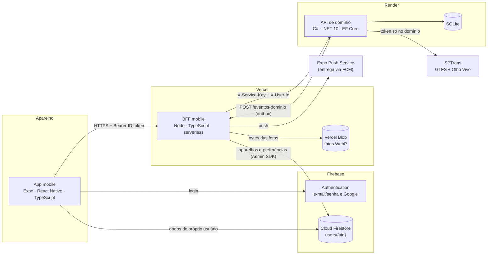
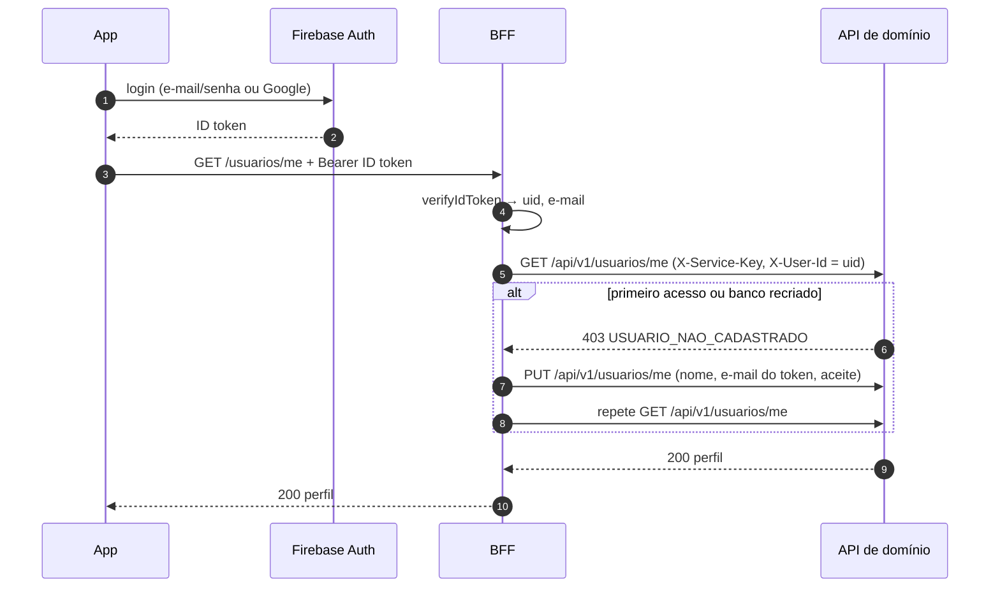
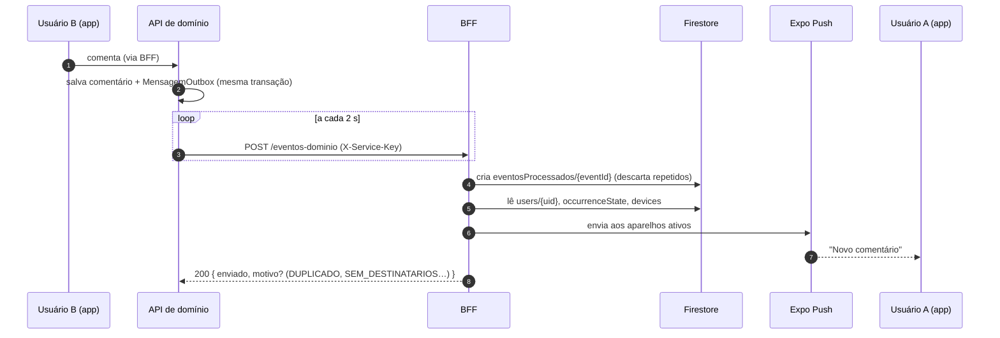
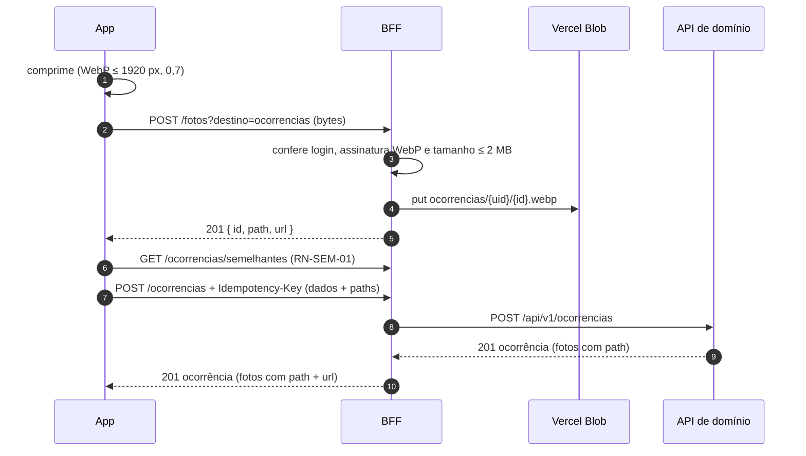

# 08 — Arquitetura

Visão técnica do Colecity v1. As regras de negócio estão em [07 — Regras de negócio do produto](07-regras-de-negocio-produto.md). Este documento diz **onde** cada regra é implementada e **como** as partes conversam. O contrato BFF ↔ domínio está em [10](10-contrato-api-dominio.md), e a stack do app em [09](09-stack-mobile.md).

## 1. Visão geral



Princípio: **o domínio não conhece plataformas.** Ele não sabe o que é Firebase, push, tela ou aparelho. Tudo o que é específico do app mobile fica no BFF ou no próprio app.

## 2. Hospedagem e serviços

Tudo roda em planos gratuitos, sem cartão (decisões 30 a 32 do [doc 06](06-decisoes-e-perguntas.md)):

| Parte | Onde | Uso |
|---|---|---|
| App | APK (EAS Build) / Expo Go | Telas, cache, fila offline, login |
| Firebase Authentication | Firebase (plano Spark) | Login com e-mail/senha e Google; sessão do app |
| Cloud Firestore | Firebase (plano Spark) | Só os dados do próprio usuário (seção 8) |
| BFF mobile | Vercel (Hobby), pasta `bff/` | Funções serverless em Node + TypeScript, sem framework web |
| Vercel Blob | Vercel | Fotos de ocorrências e comentários (seção 9) |
| API de domínio | Render (gratuito, Docker), pasta `backend/` | Regras de negócio, banco, SPTrans, outbox |
| Expo Push Service | Expo | Envio do push ao Android (entrega via FCM) |

O plano gratuito do Render dorme depois de cerca de 15 minutos sem uso, e um ping externo a cada 5 minutos (cron-job.org em `/health`) o mantém acordado. O disco do container não é persistente: a cada deploy, o banco volta ao da imagem (migrations e GTFS já importados no build) e recebe o seed de demonstração.

## 3. Responsabilidades por camada

### 3.1 App mobile (Expo, React Native, TypeScript)
- Telas, navegação (Expo Router) e acessibilidade (RN-GER-01 a 05).
- Login e cadastro pelo SDK do Firebase Auth (e-mail/senha e Google). A sessão é mantida pelo SDK (RN-GER-13).
- Compressão das imagens antes do envio: WebP, maior lado ≤ 1920 px, qualidade 0,7 (RN-REG-04).
- Envio das fotos ao BFF (`POST /fotos`), que devolve o `path` usado nas criações.
- Cache e offline com TanStack Query persistido no AsyncStorage. A fila de ações offline é sincronizada quando a conexão volta (RN-GER-09, RN-GER-10).
- Grava **direto no Firestore**, protegido por regras de segurança, só os dados do próprio usuário: aceite dos termos, preferência de notificações, ocorrências silenciadas, última visita e aparelhos para push (RN-MIN-04, RN-NOT-04).
- Pede permissão de localização só no momento de uso (RN-GER-07).
- Transporte ao vivo: envia a posição a cada minuto enquanto a viagem está ativa e o app aberto (RN-TAV-04, 05, 08).
- Recebe o push e abre a ocorrência pelo `occurrenceId` do payload (RN-NOT-05).
- Atualiza o detalhe e os comentários a cada 20 s enquanto a tela está aberta e o app em primeiro plano.
- Envia em toda chamada ao BFF o header `Authorization: Bearer <ID token do Firebase>`.

### 3.2 BFF mobile (`bff/`, Vercel)
Funções serverless (`@vercel/node`) com rewrites no `vercel.json`:

| Função | Rotas | Responsabilidade |
|---|---|---|
| `api/proxy.ts` | Todas as rotas do app (seção 11) | Valida o token, repassa ao domínio e acrescenta as URLs das fotos |
| `api/fotos.ts` | `POST /fotos` | Guarda a foto no Blob e devolve `{ id, path, url }` |
| `api/eventos-dominio.ts` | `POST /eventos-dominio` | Recebe os eventos do domínio e envia o push |
| `api/health.ts` | `GET /health` | Configuração, domínio no ar e fotos configuradas |

- Valida o ID token do Firebase (`firebase-admin`), obtém o `uid` e repassa ao domínio em `X-User-Id`, junto da credencial de serviço `X-Service-Key`. Sem token, a chamada segue sem usuário: as consultas públicas funcionam e as rotas 🔒 voltam `401` do domínio.
- **Recadastro automático:** se o domínio responder `403 USUARIO_NAO_CADASTRADO` (primeiro acesso, ou banco do Render recriado), o BFF cadastra o usuário (`PUT /usuarios/me`, com o e-mail do token e o aceite guardado em `bffUsuarios/{uid}`) e repete a chamada uma vez (RN-CON-01, RN-CON-11). Depois de `DELETE /usuarios/me`, o registro é apagado e a conta não é recadastrada.
- Não reimplementa regras: modelos, paginação, `Idempotency-Key` e erros do domínio passam sem alteração.
- As rotas de moderação (`/admin`) não são expostas ao app.
- **Push:** os destinatários vêm calculados pelo domínio. O BFF remove quem desligou as notificações ou silenciou a ocorrência, envia todo comentário, sem limite de tempo (RN-NOT-02, RN-NOT-04), evita repetição pelo `eventId` e desativa tokens recusados (`DeviceNotRegistered`).
- O texto do push usa só o título público da ocorrência. O payload leva `occurrenceId`.
- **Rate limit (RN-GER-12):** fica no domínio. Funções serverless não guardam estado entre execuções, então um limite em memória no BFF não seria confiável.
- Detalhes das rotas em [`bff/README.md`](../bff/README.md).

### 3.3 API de domínio (`backend/`, C#/.NET 10, EF Core)
Dona de **todas** as regras de negócio do doc 07:
- Usuários do domínio (nome público, aceite de termos, anonimização).
- Ocorrências: categorias, tipos, registro, edição, título gerado, validação de território (município de São Paulo).
- Ocorrências semelhantes (RN-SEM).
- Participação e contagens (RN-PAR).
- Comentários e moderação (RN-COM, RN-MOD).
- Estados, conclusão, reabertura (com transferência de autoria) e encerramento automático (RN-ACO).
- Mapa de calor e Zona de atenção (RN-DES, RN-ZON).
- Transporte ao vivo: GTFS, Olho Vivo, posições de passageiros e detecção de desvio (RN-TAV).
- Validação das fotos: só referências WebP na pasta do próprio usuário (RN-REG-04).
- Publica **eventos de domínio** pelo padrão Outbox (seção 5).
- Rate limit por usuário (`X-User-Id`) ou, sem usuário, por IP. No Render, `RateLimit__RequisicoesPorMinuto=120`, porque as consultas anônimas chegam todas do IP do BFF.
- OpenAPI (Swagger e Scalar), migrations e testes (critérios de C# e SOA). Detalhes em [`backend/README.md`](../backend/README.md).

## 4. Identidade e autenticação



1. O domínio não guarda senha nem trata login. Guarda o `uid` do Firebase, o nome público e o aceite dos termos.
2. A comunicação BFF → domínio é protegida pela credencial de serviço, que fica só nas variáveis de ambiente da Vercel e do Render. O domínio recusa chamadas sem ela (`401`).
3. O app **nunca** envia `X-Service-Key` nem `X-User-Id`.

Configurações do Firebase Auth exigidas pelas regras:
- Provedores: e-mail/senha e Google.
- Política de senha: mínimo de 8 caracteres, com letra e número (RN-CON-03).
- Proteção contra enumeração de e-mails ativada (RN-CON-09).
- "Uma conta por endereço de e-mail" (RN-CON-12).

## 5. Eventos do domínio → BFF (push)

O domínio grava o evento na tabela de outbox, **na mesma transação** da operação. Uma tarefa em segundo plano envia os pendentes a cada 2 s, com até 3 tentativas.



| Evento | Quando |
|---|---|
| `ocorrencia.estado_alterado` | Concluída, reaberta, em acompanhamento |
| `ocorrencia.comentario_criado` | Novo comentário |
| `transporte.desvio_confirmado` | Desvio confirmado numa linha |

Cada evento tem um `eventId` único. O domínio envia os destinatários já calculados (`destinatariosUids`: autor, afetados e apoiadores, sem quem fez a ação). O formato completo do envelope está no doc 10, seção 5.

## 6. Fluxos principais

### 6.1 Registro de ocorrência com fotos



Sem conexão, a ação vai para a fila local e é executada na ordem quando a conexão volta (RN-GER-10). A `Idempotency-Key` evita duplicar a ocorrência numa nova tentativa.

### 6.2 Transporte ao vivo
1. A pessoa busca a linha (GTFS, via domínio) e vê o trajeto oficial e os ônibus da Olho Vivo, marcados como "SPTrans".
2. Ao tocar em "Estou neste ônibus", o app inicia a viagem e envia a posição a cada minuto ao BFF, que repassa ao domínio.
3. O domínio compara cada posição com o trajeto oficial. Com 3 posições seguidas a mais de 300 m, a resposta traz `desvioSuspeito` e o app pergunta "O ônibus mudou de rota?" (RN-TAV-07).
4. Se a pessoa confirmar, o domínio cria ou reforça a ocorrência "Alteração de rota sem aviso" na linha e publica `transporte.desvio_confirmado`.
5. A viagem termina quando a pessoa encerra, depois de 2 horas ou depois de 10 minutos parada fora do trajeto (RN-TAV-05).
6. O token da SPTrans fica só no domínio. Sem token, o domínio usa uma simulação com o mesmo contrato.

## 7. Segredos e configuração

| Segredo | Onde fica | Nunca |
|---|---|---|
| Token da SPTrans (Olho Vivo) | Variável de ambiente do Render (`SpTrans__Token`) | No app, no BFF ou no repositório |
| Credencial de serviço BFF ↔ domínio | Render (`Seguranca__ServiceKey`, `Bff__ServiceKey`) e Vercel (`DOMINIO_SERVICE_KEY`), com o mesmo valor | No app ou no repositório |
| Credencial de moderação | Render (`Seguranca__AdminKey`) | No app, no BFF ou no repositório |
| Conta de serviço do Firebase | Vercel (`FIREBASE_CLIENT_EMAIL`, `FIREBASE_PRIVATE_KEY`) | No repositório |
| Token do Vercel Blob | Vercel (`BLOB_READ_WRITE_TOKEN`) | No app ou no repositório |
| Configuração pública do Firebase | No app (`firebaseConfig.json`, versionado de propósito) | — |

Os arquivos `.env.example` trazem só os nomes das variáveis.

## 8. Firestore — estrutura e regras

```
users/{uid}                              (app: só o dono)
  aceiteTermosVersao: string
  notificationsEnabled: boolean
  criadoEm, updatedAt: string ISO
users/{uid}/occurrenceState/{ocorrenciaId}
  muted: boolean
  lastSeenAt: string ISO | null
users/{uid}/devices/{deviceId}
  token: string (Expo push token)
  plataforma: "android"
  enabled: boolean
  updatedAt: string ISO

bffUsuarios/{uid}                        (só o BFF, Admin SDK)
eventosProcessados/{eventId}             (só o BFF)
```

Regras de segurança versionadas em [`mobile/firestore.rules`](../mobile/firestore.rules):
- `users/{uid}` e subcoleções: leitura e escrita só pelo próprio usuário autenticado (`request.auth.uid == uid`), com lista fechada de campos e tipos conferidos.
- Tokens de dispositivo nunca são legíveis por outros usuários.
- Qualquer outro caminho, incluindo as coleções do BFF, fica negado para o app. O Admin SDK do BFF não passa pelas regras.
- Nenhuma regra aberta (`allow read, write: if true`).

## 9. Fotos — Vercel Blob

O Firebase Storage exige o plano pago, e o disco do Render gratuito não é persistente. Por isso os bytes ficam no **Vercel Blob**, e o domínio guarda só a referência (decisão 31 do doc 06):
- Só o BFF escreve, com o ID token conferido. O app nunca tem a chave do armazenamento.
- O caminho é decidido pelo BFF: `{ocorrencias|comentarios}/{uid}/{id}.webp`. O domínio confere que a foto está na pasta de quem envia (doc 10, seção 3.1).
- O BFF aceita só WebP, conferindo a assinatura do arquivo (`RIFF....WEBP`), até 2 MB (RN-REG-04).
- A leitura é pública, porque as fotos aparecem em ocorrências públicas. O BFF acrescenta a `url` nas respostas.

## 10. Banco do domínio

EF Core com SQLite e migrations. As consultas por raio filtram por caixa delimitadora no banco e calculam a distância exata (Haversine) em memória. A distância ao trajeto usa projeção local sobre os pontos do GTFS. O mapa de calor é agregado no banco (`GROUP BY` com `COUNT DISTINCT` de afetados).

Tarefas em segundo plano:

| Tarefa | Intervalo | O que faz |
|---|---|---|
| `PublicadorEventosTarefa` | 2 s | Envia o outbox ao BFF (até 3 tentativas) |
| `ZonasAtencaoTarefa` | 5 min | Recalcula as Zonas de atenção (RN-ZON) |
| `GeocodificacaoPendenteTarefa` | 5 min | Completa os títulos com o endereço (Nominatim) |
| `EncerramentoAutomaticoTarefa` | 1 h | Conclui ocorrências inativas (RN-ACO-06, RN-ACO-09) |
| `LimpezaTarefa` | 1 h | Encerra viagens expiradas (2 h) e apaga posições de passageiros e chaves de idempotência com mais de 24 h e o outbox enviado há mais de 7 dias (RN-TAV-05, 06) |
| `GtfsImportador` | 1 dia | Reimporta o GTFS (desligado na imagem Docker, que já traz o banco importado) |

GTFS: em produção, a imagem usa o GTFS real da SPTrans (`backend/gtfs-sptrans/`, todas as linhas de ônibus, trajetos simplificados a 10 m). Os testes e o `dotnet run` local usam a amostra de 4 linhas embutida no projeto (decisão 35 do doc 06).

## 11. Contrato app ↔ BFF

- Base: `EXPO_PUBLIC_BFF_URL` (hoje `https://push-api-rho.vercel.app`).
- Os modelos, enums, paginação e erros (`code`) **espelham o doc 10**. Os caminhos são agrupados por recurso, e o BFF converte para os do domínio (`bff/src/rotas.ts`):

| App → BFF | BFF → domínio (`/api/v1`) |
|---|---|
| `/usuarios/me…` | `/usuarios/me…` |
| `/ocorrencias/categorias` | `/categorias` |
| `/ocorrencias/mapa/calor`, `/ocorrencias/mapa/zonas-atencao` | `/mapa/calor`, `/mapa/zonas-atencao` |
| `/ocorrencias…` | `/ocorrencias…` |
| `/participacoes/{id}/{afetado\|apoio}` | `/ocorrencias/{id}/participacoes/{afetado\|apoio}` |
| `/comentarios/ocorrencia/{id}` | `/ocorrencias/{id}/comentarios` |
| `/comentarios/{id}` | `/comentarios/{id}` |
| `/comentarios/denuncias` | `/denuncias` |
| `/transporte/…` | `/transporte/…` |
| `POST /fotos` | — (só no BFF) |
| `GET /health` | — (o BFF consulta `/health` do domínio) |

- Autenticação: `Authorization: Bearer <ID token do Firebase>`.
- `Idempotency-Key` é enviado pelo app nas criações (fila offline) e repassado ao domínio.

## 12. Histórico

O desenho original previa o BFF em Firebase Cloud Functions, as fotos no Firebase Storage e o push por FCM direto, tudo no plano Blaze (decisão 20 do doc 06). Sem cartão para o plano pago, a hospedagem mudou: primeiro, o app gravou o domínio no Firestore e o push saiu de uma API própria (`push-api/`). Depois, em 18/11/2026, veio a integração ponta a ponta descrita neste documento: `push-api/` virou o BFF, o domínio C# passou a ser a única fonte das regras e o Firestore ficou só com `users/{uid}` (decisões 30 a 35 do doc 06).
